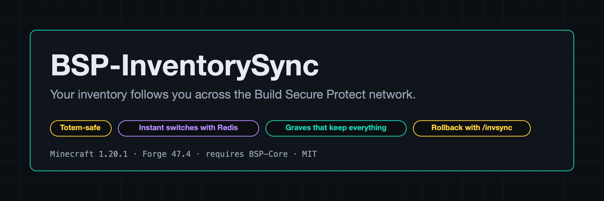
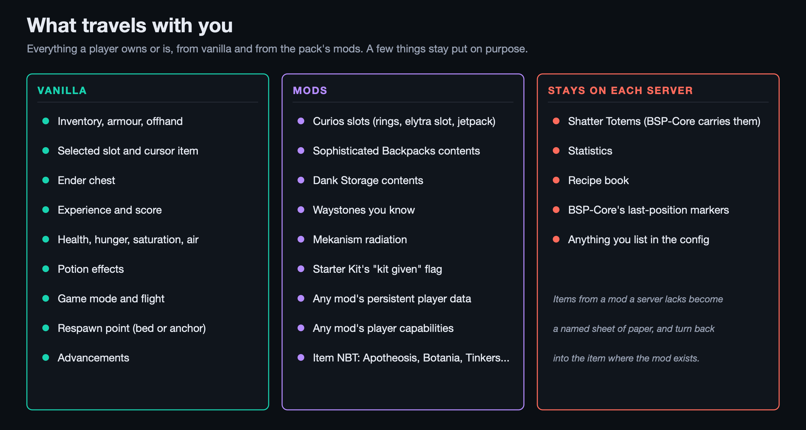
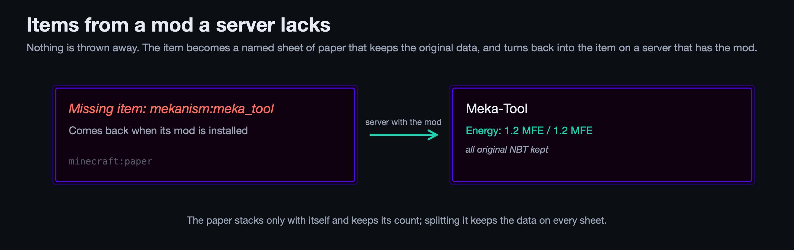
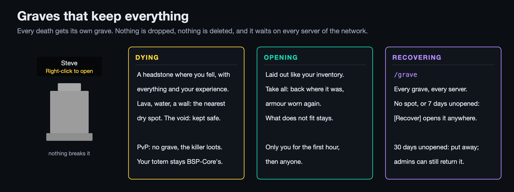
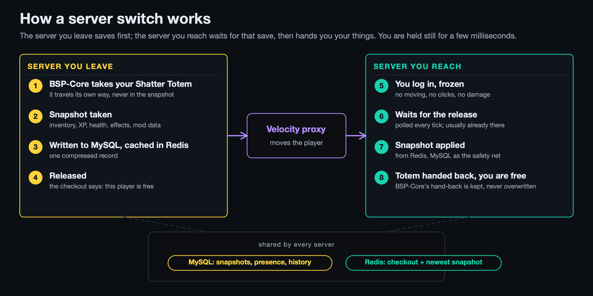
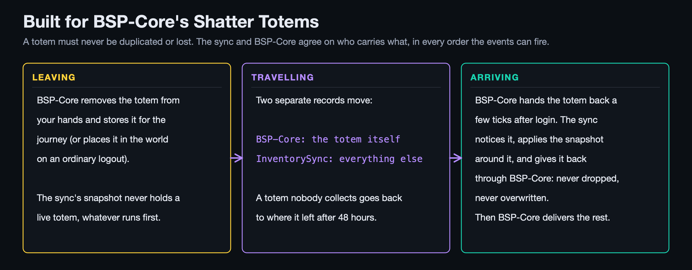
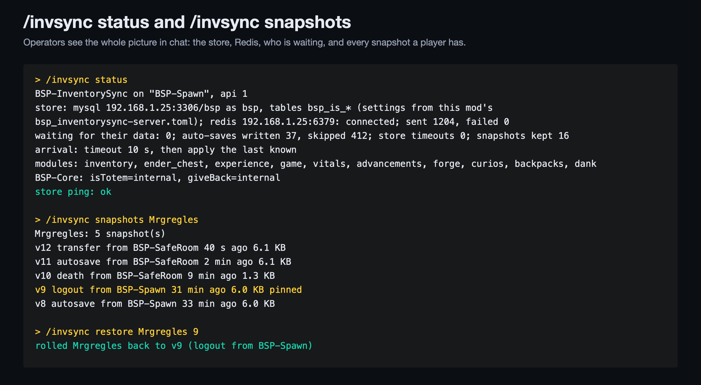
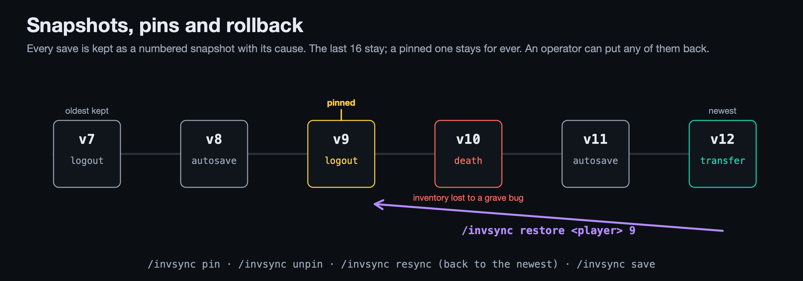

# BSP-InventorySync

**Your inventory follows you across the Build Secure Protect network.** Move from one BSP server to another and everything you carry and everything about your character is already there: inventory, armour, ender chest, experience, health, effects, and the per-player data of the pack's mods. Built for the BSP network, where [BSP-Core](https://www.curseforge.com/minecraft/mc-mods/bsp-core)'s Shatter Totems must never be duplicated or lost. And when you die, everything you carried waits for you in a grave that nothing can break.

Needed on the servers and, in exactly the same version, in the players' modpack (for the grave block). Minecraft 1.20.1, Forge 47.4. Requires BSP-Core. MIT licence, source on [GitHub](https://github.com/Build-Secure-Protect/BSP-InventorySync).

---

## For players

There is nothing to learn. When you switch servers you are held still for a moment while your things arrive, usually too short to notice, and then you carry on where you left off. If the server you came from is slow, you wait at most ten seconds and are told if anything could be out of date.

**What travels with you**

- Inventory, armour, offhand, your selected slot and the item on your cursor.
- Ender chest.
- Experience, level progress and score.
- Health, hunger, saturation, air and potion effects.
- Game mode and flight. Your respawn point (bed or anchor) stays with each server, since each has its own world.
- Advancements, without earning their rewards twice.
- Curios slots, Sophisticated Backpacks contents (including backpacks inside backpacks), Dank Storage contents, the waystones you know, Mekanism radiation, and any other mod's per-player data.

**What stays on each server**

Your Shatter Totem, which BSP-Core carries its own way (see below); statistics and the recipe book.

**Items from a mod a server lacks**

If you arrive on a server that does not have one of your items' mods, the item becomes a barrier named after it. It cannot be crafted, traded or placed, so nothing is lost: the barrier keeps all the original data and turns back into the item on a server that has the mod.

---

## Graves

When you die, a headstone appears where you fell, holding everything you would have dropped and your experience. It replaces Simply Graves, with what players missed there fixed.

- **Every death gets its own grave.** Dying on the way back never touches the first one.
- **Right-click it** to open it: a chest screen laid out like your inventory (main rows, hotbar, armour, offhand). Click a stack to take it, or Take all: everything goes back into the slot it came from (armour is worn again). What does not fit stays in the grave until you make room; nothing is dropped or deleted.
- **Only you, for the first hour**, then anyone. The first to open it gets the experience.
- **No grave for a PvP death**: the items drop as usual, for the killer. Your Shatter Totem is never in a grave; BSP-Core handles it, and the grave never takes its spot.
- **Nothing breaks it**: not a pickaxe in creative mode, explosions, pistons, water, lava, fire, the wither or the dragon. Claims and regions never keep you out of your own grave.
- **In lava, water, a wall or the void?** It goes to the nearest dry spot, or where you last stood on solid ground. If there is nowhere at all, it is kept safe and you recover it with `/grave`.
- **`/grave`** lists your graves on every server of the network. A grave that found no spot, or that nobody opened for 7 days, has a [Recover] link: it opens right where you are, on any server. Backpack and dank contents come with their items.
- A grave nobody opens for 30 days is put away (admins can still return it) and deleted 30 days after that.

---

## For server admins: installing

1. Put the jar in `mods/` on every backend, next to BSP-Core 1.1.0 or newer, and the same jar in the players' modpack: a player with another version, or without it, is refused at login. Remove Simply Graves from both (this mod's graves stay off while it is installed).
2. Start each server once. The config appears at `<world>/serverconfig/bsp_inventorysync-server.toml`.
3. Set `storage.mode = "mysql"`. By default the database settings and this server's name are read from BSP-Core's (its connection is in `config/bsp_core-network.toml`), so a network already running BSP-Core on MySQL needs nothing more. Set `storage.useBspCoreDatabase = false` to give this mod its own host, user and password instead: those go in `config/bsp_inventorysync-network.toml`, which stays on the server (the server config is sent to every player, so it holds no passwords).
4. Optional but recommended: set `redis.enabled = true`, with your Redis host and password in `config/bsp_inventorysync-network.toml`. Redis makes switches instant; without it a switch waits only for the source server's save to land in MySQL.
5. Restart, or run `/invsync reload`. The log says "tables ready on mysql ..." and, with Redis, "redis host:port connected". `/invsync status` shows the same.

Every backend must point at the same database and the same Redis, and each must have a different server name that equals its Velocity server name.

---

## How a server switch works

The server you leave takes a snapshot, writes it to MySQL and caches it in Redis, then marks you as released. The server you reach freezes you on login, polls for that release every tick, and applies the snapshot the moment it sees it. Nothing you could do while frozen can duplicate the stale copy that server had of you: no moving, no clicks, no pickups or drops, no damage.

If the release does not come within the timeout (`arrival.timeoutSeconds`, 10 by default), the server applies the last snapshot it can find and tells you it may be out of date. Admins who prefer the strict behaviour set `arrival.kickOnTimeout = true` and the login is refused instead, so the player can try again.

A player who disconnects before their data arrived is never saved over. A player who arrives dead gets their data at the respawn.

---

## Built for BSP-Core's Shatter Totems

BSP-Core already handles a totem when its owner leaves: it is placed in the world on an ordinary logout, or stored for the journey when BSP-Teleport sends the player to another server. BSP-InventorySync never writes a live totem into a snapshot, whatever order the logout events fire in, so the sync can never duplicate one. On arrival, BSP-Core hands the totem back a few ticks after login; the sync keeps it, applies the snapshot around it and gives it back through BSP-Core, so it is never dropped or overwritten. BSP-Core then delivers pending items and runs its season coin check only after the restore.

---

## Admin commands

Everything an operator needs is under `/invsync` (permission level 2; the editor level 3). Its screens are vanilla chest screens.

| Command | What it does |
|---|---|
| `/invsync status` | This server's name, the database and Redis state, how many players are waiting for their data, the auto-save counters, the data modules, and a database ping. |
| `/invsync snapshots <player>` | The player's snapshots, newest first: version, cause (logout, transfer, death, autosave, world_save, admin), which server saved it, how long ago, how big, pinned or not. Works for offline players the server knows. |
| `/invsync restore <player> <version>` | Puts that snapshot back on an online player. The way to undo a loss. |
| `/invsync resync <player>` | Applies the newest snapshot again. |
| `/invsync pin <player> <version>` / `unpin` | A pinned snapshot is never removed by rotation. |
| `/invsync save <player>` | Takes a snapshot now. |
| `/invsync dump <player>` | Shows how big each part of the player's data is and writes the whole thing as readable text under `world/bsp_inventorysync/dumps/`, for a bug report. |
| `/invsync give <player> <item> [count]` | Gives an item on any server of the network, and from the console. What fits goes in at once; the rest waits for the player wherever they are, and they are asked in a small chest screen to make room, then click Deposit. Offline players get it at their next login. Shatter Totems are refused. |
| `/invsync edit <player>` | Opens the player's inventory and ender chest in a chest screen (level 3), with a creative item list, Trash, Save and Confirm. Works for offline players on their newest snapshot. |
| `/invsync graves <player>` | Every grave of the player with its id, newest first, put-away ones too. |
| `/invsync grave open <player> <id>` | Opens that grave for you, whatever its age. |
| `/invsync grave give <player> <id> <to>` | Makes the grave that player's: they recover it with `/grave`, contents and experience included. Once only. |
| `/invsync grave remove <player> <id>` | Empties the grave for good; the log lists every stack it held. |
| `/invsync reload` | Re-reads the config and reconnects to the database and Redis without disturbing the players online. |

### Snapshots and rollback

Every save is kept as a numbered snapshot with its cause. The last 16 per player stay (`storage.snapshotsKept`); a pinned one stays for ever. When a player loses an inventory to a bug or a grief, find the snapshot from before it with `snapshots` and put it back with `restore`.

---

## Saves, performance and resilience

- Saves happen on logout, on server transfer, on death (at the respawn, so the drops have left the inventory), on world save, and every 60 seconds (`storage.autosaveSeconds`) for players whose data changed since their last save. An unchanged player costs no database write; an idle one touches no file either.
- One compressed record per snapshot. Every data module runs on its own, so one failing integration never costs a player the rest of their data.
- MySQL through plain JDBC; no database driver is bundled, so nothing clashes with the server's own. Redis through the mod's own small client; nothing bundled there either.
- A watchdog (`storage.timeoutSeconds`, 5) gives up on any database or Redis call that does not answer, so a frozen database never leaves a player frozen or the server hanging on shutdown. A Redis outage is logged once and MySQL carries on alone.

---

## Compatibility

**BSP-Core** (required). BSP-Core's Shatter Totems are the reason this mod exists rather than a generic sync: the totem rule above, the hand-back on arrival, and BSP-Core's deliveries and season coin check waiting for the restore. The database settings and server id are shared with BSP-Core's config by default, so the network is set up once.

**BSP-Teleport** (optional). BSP-Teleport's cross-server teleports are server switches like any other and are handled by the handshake with nothing to configure: BSP-Teleport's landing happens first, the restore follows while the player is still frozen at the landing point. The api also offers `beginTransfer`, which a teleport mod can call just before the proxy switch so the save is already in flight when the player leaves.

**Simply Graves** (replaced). Remove it from the servers and the pack; while it is installed this mod's graves stay off, so nothing is handled twice. Graves Simply Graves still holds are not carried over: collect them before removing it.

**Curios, Sophisticated Backpacks, Dank Storage** (optional). Each has its own adapter that registers only when the mod is present. Any other mod's per-player data travels through the generic module without an adapter.

---

## For mod developers

Package `com.mrgregles.bsp_inventorysync.api`: register a `DataModule` to carry your own per-player data with the snapshot, exclude items from snapshots, ask `isSyncing(uuid)` before trusting a player's inventory, or announce a transfer. Two Forge events on the server thread: `InventorySavedEvent` when a snapshot has landed in the store, and `InventoryRestoredEvent` once per restore after the data modules have run. Details in [docs/API.md](https://github.com/Build-Secure-Protect/BSP-InventorySync/blob/main/docs/API.md).

---

Part of the **Build Secure Protect** family: [BSP-Core](https://www.curseforge.com/minecraft/mc-mods/bsp-core), BSP-Teleport, BSP-Region Guard and BSP-InventorySync. Design modelled on PlayerSync, PlayerSync Performance Plus and HuskSync; written from scratch under the MIT licence.
